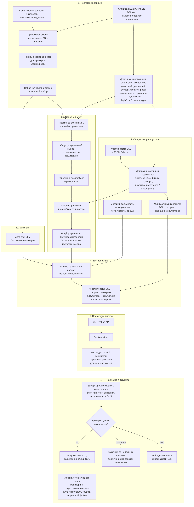
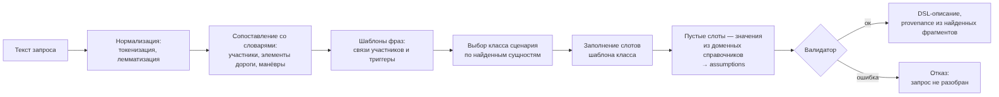
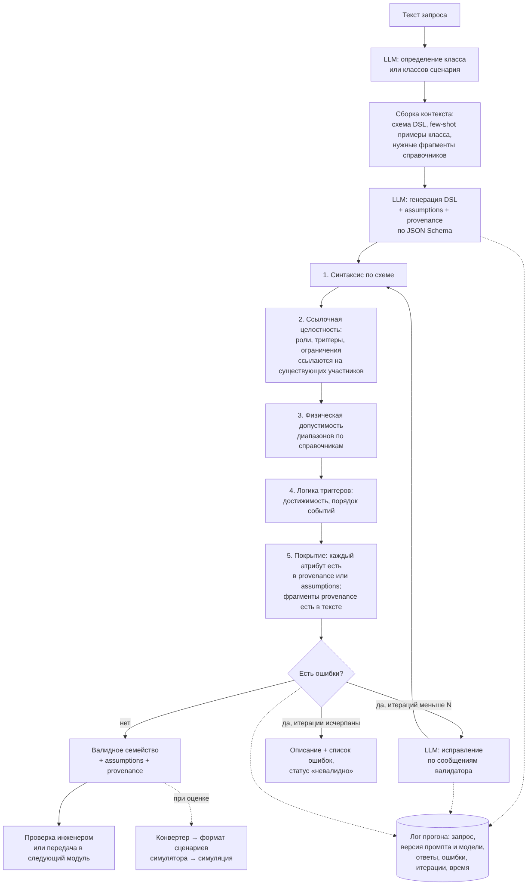

*Перевод текстового описания тестового сценария в структурированный сценарий (DSL), пригодный  для исполнения в симуляторе автономного транспорта**

*Автор*: Алла Жукова

### 1. Цели и предпосылки 
#### 1.1. Зачем идем в разработку продукта?  

##### Бизнес-цель

Создание синтетического сценария для воспроизведения дорожной ситуации в симуляторе требует больших временных и трудовых затрат инженера по тестированию. Хочется сократить эти траты и сделать этот процесс автоматизируемым.

Сейчас каждый новый сценарий описывается инженером вручную в редакторе путем перетаскивания всех участников дорожной ситуации на сцену, расположении их в нужно точке на карте, задания параметров появления и поведения - это часы работы на сценарий. В результате:

- тестовые датасеты растут медленнее, чем расширяется ODD, и часть ситуаций остаётся непроверенной до выезда на дорогу, где поиск проблем обходится многократно дороже;

- создание сценариев требует знания спецификы работы с ручным редактором сценариев, поэтому описать тест может только узкий круг специалистов, и они становятся узким местом;

- сценарий нельзя создать без участия человека, поэтому невозможно встроить его генерацию в автоматические цепочки: регрессии по инцидентам, проверку гипотез о слабостях планировщика, расширение покрытия ODD.

Данный проект переводит описание сценария на естественном языке в формальное, проверенное описание на структурированном CHASSIS DSL. Такое описание конвертируется в сценарий, который может быть проигран в симуляторе. Это даёт два эффекта: инженер создаёт сценарии в разы быстрее и без знания формата, а другие системы и агенты в будущем получают программный интерфейс для создания сценариев.

##### Почему станет лучше, чем сейчас

Текущие альтернативы и их ограничения:

| Подход | Ограничение |
| Ручное создание в редакторе или скриптом | часы на сценарий, нужна экспертиза в формате, не масштабируется, не автоматизируется |
| Шаблоны и параметрические генераторы | покрывают только заранее предусмотренные типы сценариев, каждый новый тип требует разработки нового шаблона |
| Rule-based разбор текста (ключевые слова, шаблоны фраз) | ломается на свободных формулировках, не справляется с композиционными сценариями из нескольких взаимодействующих участников, требует постоянной поддержки словарей | 

Что даёт LLM, чего нет у альтернатив:

- понимание свободного текста: инженер пишет так, как думает, а не заполняет форму; работает и с текстами, которые изначально не предназначались для генерации (отчёты о ДТП, правила, требования);
- предварительные расчеты и композиционность: модель рассчитывает необходимвые скорости и расстояния, чтобы выполнить условия промпта, а также сценарии с несколькими участниками и согласованными триггерами описываются одной фразой, а не набором шаблонов. Например, по инструкции "пешеход появляется на зебре за 3 секунды до приближения эго" модуль настраивает время спавна, место и триггер спавна.

Почему результат будет надёжным, несмотря на ML. LLM используется только там, где нужно понимание языка. Геометрию и траектории модель не генерирует, а все её выходы проходят детерминированную проверку по схеме и правилам с циклом исправления. Всё, что модель додумала, явно помечается как допущение, и каждый атрибут связан с фрагментом исходного текста. Поэтому инженер проверяет готовое описание за минуты, а не пишет его часами.

Что ML не заменяет. Окончательное решение о включении сценария в библиотеку остаётся за инженером. Модуль сокращает время создания, а не отменяет экспертизу.

##### Что будем считать успехом итерации с точки зрения бизнеса

Первая итерация — MVP модуля, проверенный на реальных задачах инженеров.

Критерии успеха:

- время создания сценария сокращено не менее чем в 3 раза по сравнению с ручным созданием на одинаковом наборе задач. Учитывается полное время, включая проверку и правку результата инженером;
- не менее 70% описаний принимаются инженерами без правок или с незначительными правками (до 2 изменённых атрибутов);
- не менее 80% описаний проходят валидацию и успешно преобразуются следующими модулями в исполнимые сценарии симулятора;
- модуль работает на открытой модели внутри контура компании со временем ответа не более 30 секунд на запрос, без передачи данных во внешние API;
- модуль доступен как программный интерфейс (Python API, MCP) и вызывается из автоматической цепочки без участия человека.

Критерии остановки или пересмотра подхода:

- проверка и правка результата занимают у инженеров сопоставимое с ручным созданием время;
- доля описаний, принятых без существенных правок, ниже 50%;
- качество приемлемо только на коммерческих API, а на локальных моделях нет, и это блокирует внедрение из-за требований к конфиденциальности.

#### 1.2. Бизнес-требования и ограничения  

Краткое описание БТ и ссылки на детальные документы

Модуль Scenario Author должен:

Принимать описание тестового сценария на естественном языке (русский и английский): свободный текст инженера, формулировку требования, правило дорожного движения, текстовое описание инцидента.
Возвращать параметризованное семейство сценариев на CHASSIS DSL: участники, роли, манёвры, триггеры взаимодействий, диапазоны параметров, ограничения.
Гарантировать корректность результата: каждое описание проходит проверку по схеме и правилам, невалидный результат не выдаётся без пометки об ошибке.
Явно показывать, что модель додумала (assumptions), и из какого фрагмента текста получен каждый атрибут (provenance), чтобы инженер мог быстро проверить результат.
Работать в двух режимах: интерактивном (инженер через CLI) и автоматическом (вызов из других систем и агентов через Python API и MCP, включая пакетную обработку).
Выдавать результат, пригодный для обработки следующими модулями CHASSIS (привязка к карте, сэмплирование, конвертация в формат симулятора) без ручной доработки.

Детальные документы:

README.md — описание модуля, архитектура, метрики;
docs/dsl-spec.md — спецификация CHASSIS DSL (в работе);
benchmark/README.md — протокол разметки корпуса и эталонных описаний (в работе).

Бизнес-ограничения

1) Конфиденциальность. Описания сценариев и инцидентов могут содержать чувствительные данные компании, поэтому основной режим — открытые модели, развёрнутые локально. Коммерческие API используются только на публичных данных как верхняя планка сравнения.
2) Инфраструктура. Модуль должен работать на виртуальных машинах с GPU.
3) Время ответа. Не более 30 секунд на запрос в интерактивном режиме.
4) Безопасность процесса. Сгенерированный сценарий попадает в библиотеку тестов только после одобрения инженером. Модуль ускоряет работу, но не принимает решений вместо человека.
5) Границы ответственности. Модуль не генерирует геометрию, координаты и траектории: это зона детерминированных инструментов следующих модулей.
6) Совместимость. Формат DSL версионируется, изменения схемы не должны ломать уже созданные описания без миграции.

Что мы ожидаем от конкретной итерации

Входит в итерацию:

- CHASSIS DSL v0.1, покрывающий базовые классы городских сценариев: пешеход на переходе и вне перехода, выход из "слепой зоны", перестроение и подрезание, следование за лидером с резким торможением, проезд нерегулируемого перекрёстка;
- перевод «текст → DSL» с допущениями и прослеживаемостью;
- многоуровневая валидация и цикл исправления;
- CLI, Python API, интеграция с симулятором;
- бенчмарк: корпус запросов, эталонные описания, перефразировки;
- сравнение с baseline (шаблонный разборщик, zero-shot LLM);
- конвертер в сценарии симулятора, чтобы проверять исполнимость описаний.

Не входит в итерацию:

- оценка реалистичности;
- многоходовый диалог с уточнением сценария;
- сценарии вне городского ODD (магистрали, парковки, внедорожье).

Описание бизнес-процесса пилота

Текущий процесс:
источник сценария (требование, инцидент, идея инженера) → инженер вручную создает сценарий в редакторе (вручную расставляя акторов, их маршруты, триггеры и моменты появления) → запуск и отладка → добавление в набор тестов.

Процесс с моделью, интерактивный режим:

1) Инженер формулирует сценарий текстом.
2) Scenario Author возвращает DSL-описание со списком допущений.
3) Инженер проверяет результат: принимает, правит отдельные атрибуты или переформулирует запрос.
4) Следующие модули конвертируют описание в исполнимый сценарий, он запускается в симуляторе.
5) Инженер добавляет сценарий в датасет.

Процесс с моделью, автоматический режим:

Внешний скрипт или агент передаёт пакет описаний (например, список требований или правил).
Модуль возвращает DSL-описания, невалидные помечаются.
Результаты попадают в очередь на проверку инженеру, одобренные — в библиотеку.

Организация пилота:

- 3–5 инженеров или экспертов в предметной области;
- набор из примерно 30 задач на создание сценариев разной сложности (простые, с несколькими участниками, композиционные с триггерами);
- перекрёстная схема: каждый участник выполняет часть задач вручную, часть с инструментом, задачи чередуются между группами, чтобы исключить влияние сложности конкретной задачи;
- фиксируются время создания, число и характер правок, доля принятых описаний, исполнимость результата;
- в конце — опрос об удобстве и готовности использовать инструмент дальше;
- длительность — 2–3 недели.

Что считаем успешным пилотом? Критерии успеха и возможные пути развития проекта

Пилот успешен, если одновременно выполнены условия:

- Полное время создания сценария, включая проверку и правку, сокращено не менее чем в 5 раз.
- Не менее 70% описаний приняты без правок или с незначительными правками (до 2 атрибутов).
- Не менее 95% описаний проходят валидацию и конвертируются в исполнимые сценарии.
- Модуль работает на локальной открытой модели с ответом не дольше 30 секунд.
- Большинство участников готовы продолжить использовать инструмент (оценка удобства по шкале SUS не ниже 70).

Пути развития в зависимости от результата:

Пилот успешен:
- Встраивание в CI команды;
- расширение DSL на новые классы сценариев и ODD;
- добавление новых источников (отчёты о ДТП, логи заездов через модуль реконструкции);
- подключение оценщика реалистичности и замкнутого контура CHASSIS.

Частичный успех (качество достаточное не для всех классов сценариев):
- Сузить область применения до классов, где модуль работает надёжно;
- использовать правки инженеров, собранные в пилоте, для дообучения компактной модели;
- добавить генерацию с ограничением по грамматике.

Пилот неуспешен (правка занимает сопоставимое с ручным созданием время):
- Перейти к гибридному интерфейсу: структурированная форма, которую LLM заполняет предложениями, а инженер подтверждает по полям;
- пересмотреть DSL, если проблема в его избыточной сложности.

#### 1.3. Что входит в скоуп проекта/итерации, что не входит 

#### На закрытие каких БТ подписываемся в данной итерации

| БТ (из п. 1.2) | Статус в итерации | Что именно закрываем |
|---|---|---|
| 1. Вход на естественном языке | частично | свободный текст инженера; краткие текстовые описания инцидентов (до одного абзаца) |
| 2. Выход — семейство на CHASSIS DSL | полностью для классов DSL v0.1 | четыре базовых классов городских сценариев: пешеход на переходе и вне его, перестроение и подрезание, резкое торможение лидера, нерегулируемый перекрёсток |
| 3. Гарантия корректности | полностью | валидация по схеме, ссылочная целостность, физическая допустимость диапазонов, логика триггеров, цикл исправления |
| 4. Допущения и прослеживаемость | полностью | поля `assumptions` и `provenance` для каждого описания |
| 5. Интерактивный и автоматический режимы | полностью | CLI, Python API, пакетная обработка |
| 6. Пригодность для следующих модулей | частично | проверяется через минимальный конвертер в сценарий симулятора на типовых картах; полная интеграция с модулями привязки к карте и сэмплирования — после их появления |

#### Что не будет закрыто

- классы сценариев вне DSL v0.1 и ODD вне города (магистрали, парковки, погодные и световые условия как самостоятельный фактор сценария);
- многоходовый диалог с уточнением сценария — уточнение только через повторный запрос;
- оценка реалистичности;
- дообучение модели — в итерации используются только промптинг и примеры в контексте.

#### Описание результата с точки зрения качества кода и воспроизводимости решения

**Код:**

- Python 3.11+, устанавливаемый пакет `chassis`, зависимости зафиксированы lock-файлом (uv);
- схема DSL описана Pydantic-моделями, из них генерируется JSON Schema для внешних потребителей;
- статическая типизация (mypy в строгом режиме для `dsl/` и `validation/`), линтер и форматтер ruff;
- тесты pytest:
  - модульные тесты валидаторов на наборе заведомо корректных и некорректных описаний;
  - golden-тесты: эталонные описания проходят валидацию и конвертацию;
  - тесты LLM-части на записанных ответах модели (без обращения к модели в CI), чтобы тесты были быстрыми и детерминированными;
  - общее покрытие не ниже 70%;
- CI (GitHub Actions): линтер, типы, тесты на каждый коммит;
- Docker-образ с модулем и инструкцией по подключению модели через API.

**Воспроизводимость экспериментов:**

- версии моделей зафиксированы по идентификатору;
- конфигурации экспериментов в YAML, каждый прогон логирует полные запросы и ответы модели, метрики и время;
- бенчмарк версионирован, разбит на train/dev/test, тестовая часть не используется при подборе промптов и примеров.

**Документация:** README, спецификация DSL с примерами для каждого класса сценариев, описание протокола разметки.

#### Описание планируемого технического долга

| Технический долг | Почему допускаем сейчас | Когда закрывать |
|---|---|---|
| Нет мониторинга качества и наблюдаемости в эксплуатации (дрейф запросов, доля невалидных ответов, время ответа) | в пилоте метрики собираются вручную из логов | при встраивании в CI команды |
| Нет автоматической регрессионной оценки при смене модели или промпта | оценка запускается вручную на бенчмарке | перед первым обновлением модели после пилота |
| Нет защиты от prompt injection во входных текстах (отчёты, требования из внешних источников) | на пилоте входы контролируются | до подключения автоматического режима к внешним источникам |
| Нет оптимизации инференса (пакетирование, кэширование похожих запросов, квантование под конкретное железо) | для пилота достаточно базовой скорости | при росте нагрузки в автоматическом режиме |
| Сбор правок инженеров только в виде логов, без пайплайна подготовки данных для дообучения | дообучение вне скоупа итерации | следующая итерация, если промптинга окажется недостаточно |
| Версионирование DSL без инструментов миграции описаний между версиями | существует одна версия схемы | при выпуске DSL v0.2 |

#### 1.4. Предпосылки решения  

#### Описание общих предпосылок решения с обоснованием от запроса бизнеса

**Тип задачи.** Это задача структурированной генерации (семантического разбора): текст на естественном языке переводится в формальное описание по заданной схеме.

##### Используемые блоки данных

| Блок данных | Содержание | Назначение |
|---|---|---|
| Входные тексты | сценарий, сформулированный инженером, описание дорожного инцидента | основной вход модуля и основа корпуса для оценки |
| Спецификация CHASSIS DSL | схема, описание полей и допустимых значений, примеры для каждого класса сценариев | контекст для LLM и основа детерминированной валидации |
| Библиотека примеров | пары «запрос → эталонное описание» из обучающей части корпуса | примеры в контексте (few-shot) для каждого класса сценариев |
| Бенчмарк | корпус запросов (train/dev/test), эталонные описания, группы перефразировок, экспертная разметка | оценка качества, подбор промптов только на train/dev |

Не используются в итерации: логи заездов, сенсорные данные и видео, закрытые данные компании. Это следует из ограничений конфиденциальности и скоупа итерации.

##### Предпосылки по модели

| Предпосылка | Решение | Обоснование |
|---|---|---|
| Тип модели | открытая LLM без дообучения, промптинг + примеры в контексте | нет обучающего набора нужного размера; быстрая итерация |
| Размер модели | порядка 20–35 млрд параметров | помещается на один GPU-сервер и даёт ответ до 15 секунд (ограничения инфраструктуры и времени ответа) |
| Лицензия модели | допускающая коммерческое использование | бизнес-ограничение |
| Формат вывода | структурированный вывод по JSON Schema, при поддержке бэкендом — генерация с ограничением по грамматике | снижает долю синтаксических ошибок (БТ 3) |
| Детерминизм | температура 0, фиксированный сид | воспроизводимость (п. 1.3) |
| Роль LLM | только понимание языка и семантика; геометрия, валидация и проверка диапазонов — детерминированный код | надёжность и проверяемость результата |

##### Предпосылки по оценке качества

- Эталонные описания создаются вручную по единому протоколу разметки.
- Атрибут считается корректным, если он совпадает с эталоном, а для числовых диапазонов — если пересечение с эталонным диапазоном составляет не менее заданной доли. Строгое совпадение чисел не требуется, потому что разумных диапазонов может быть несколько.
- Эквивалентность описаний при проверке устойчивости к перефразированию определяется на уровне нормализованной структуры (те же участники, роли, манёвры, триггеры), без учёта порядка полей и формулировок в текстовых полях.

#### 2.2. Блок-схема решения  

Этапы проекта: подготовка данных, общая инфраструктура, бейзлайн и MVP параллельными ветками, тестирование, подготовка пилота, пилот с развилкой по результату и закрытие техдолга.

Обработка запроса в бейзлайне: словари, шаблоны фраз, заполнение слотов, валидатор, без исправления ошибок.

Обработка запроса в MVP: определение класса, сборка контекста, генерация, пять уровней валидации, цикл исправления, логирование.

## Этап 1. Подготовка данных и EDA

### 1.1. Описание данных и единица наблюдения

Одна запись — описание дорожного теста (`text`) и эталонное структурированное представление (`reference_dsl`), составленное инженером по версии CHASSIS DSL. Для сохранения связей между перефразировками обязательны `request_id` и `scenario_group_id`. Рекомендуемые дополнительные поля: `language`, `scenario_class`, `source_type`, `paraphrase_group_id`, `annotation_status`, `annotator_id`, `dsl_version`. JSON эталона должен включать участников (`actors`), их роли, манёвры, условия/триггеры, относительные размещения, `environment`, `assumptions`, `provenance` — в пределах принятой версии DSL.

**Сценарные группы первой итерации:** пешеход на/вне перехода, в том числе выход из окклюзии; перестроение/подрезание; резкое торможение лидера; нерегулируемый перекрёсток. В разных местах исходного документа эти группы перечислены по-разному — до разметки необходимо утвердить единую таксономию, в которой окклюзия может быть подтипом пешеходного сценария.

### 1.2. Откуда берутся данные и как пополняются

1. Инженеры предоставляют формулировки тестовых ситуаций (включая вариации одной ситуации); исходные запросы хранятся с `source_type=engineer`, без персональных сведений.
2. Из публичных правил дорожного движения, функциональных требований и описаний инцидентов можно формировать формулировки задач; включать их в корпус только после проверки прав использования и соответствия городскому ODD. В README отдельно назван NHTSA CISS как потенциальный источник, **но фактическое извлечение этих данных пока не подтверждено**.
3. Эксперт преобразует запрос в `reference_dsl` по DSL v0.1, добавляет прослеживаемость (`provenance`) и список явно согласованных допущений (`assumptions`). Спорные образцы проверяются вторым экспертом и разрешаются согласованием.
4. Размеченный корпус сохраняется в JSONL/CSV, версия корпуса фиксируется; пополнение выполняется по мере поступления новых запросов и правок инженеров, а не автоматически по расписанию.

**Конфиденциальность:** внутренние запросы, инциденты, названия проектов и иные закрытые сведения нельзя передавать коммерческим API. До сохранения/публикации удаляются персональные и чувствительные признаки; оригиналы остаются внутри разрешённого контура. На публичных текстах допускается исследовательское сравнение с внешними моделями, но не обработка закрытых запросов.

### 1.3. EDA: предмет исследования и конкретные проверки

Ноутбук `notebooks/eda_scenario_author.ipynb` должен считать и визуализировать:

- **Состав и объём:** число записей и уникальных `scenario_group_id`, количество размеченных записей, распределение по классу (пешеход/окклюзия, cut-in, hard braking, junction), языку RU/EN, источнику и версии DSL.
- **Качество входа:** пустые тексты/ID, дубликаты, близкие перефразировки, аномалии длины текста (символы и слова), неверные `reference_dsl` JSON, доля отсутствующих обязательных метаданных.
- **Структурную сложность:** количество `actors`, уникальных ролей, манёвров, триггеров, `assumptions` и записей `provenance` на запрос; связь сложности со сценарным классом.
- **Покрытие сценариев и разметки:** дисбаланс между классами; доля запросов с несколькими участниками и связанными событиями; полнота `actors`, `environment`, `assumptions`, `provenance`; спорные числовые формулировки (скорости, расстояния, TTC, «внезапно», «резко»).
- **Утечки:** наличие одной семантической группы или её перефразировок в нескольких поднаборах, совпадения текста и идентичных DSL между наборами.

**Вывод по текущим материалам:** отсутствуют фактические записи корпуса и результаты разметки, поэтому нельзя обосновать размер банка few-shot, баланс классов, качество эталонов или достижимость целевых метрик. Выводы EDA и графики должны быть вставлены в `reports/eda_scenario_author.md` **только после запуска ноутбука на реальном корпусе**.

### 1.4. Схема разбиения и достаточность данных

Веса LLM не оптимизируются, поэтому **`few_shot_pool / dev / test`**, а не `train / val / test`:

| Набор | Назначение |
|---|---|
| `few_shot_pool` | Размеченные пары «текст → DSL», которые допускается помещать в промпт; банк примеров не является обучающей выборкой для обновления весов |
| `dev` | Подбор модели, промпта, числа few-shot примеров, constrained decoding, self-repair и экспертных правил |
| `test` | Однократная финальная оценка зафиксированного решения; не используется для настройки |
| `challenge_set` (опционально) | Независимые композиционные и противоречивые сценарии для стресс-тестирования |

Разбиение строго **по `scenario_group_id`**: исходная формулировка и все её перефразировки остаются в одной части. Доли 60/20/20 можно использовать как начальную гипотезу **только после EDA**, если каждый набор покрывает требуемые классы и достаточно независимых групп; фиксированные пропорции не заменяют проверку репрезентативности.

**Если данных мало:** в первую очередь собирать недостающие классы и композиционные случаи, а не генерировать случайные перефразировки уже хорошо представленного шаблона. Для первичного пилота можно спланировать, например, 20–30 независимых групп на каждый из четырёх укрупнённых классов (ориентир, не установленная достаточность); окончательный объём определяется доверительными интервалами ключевых метрик и доступностью экспертной разметки. Нельзя заявлять достаточность этого числа без результатов пилота.

**Необходимый результат этапа:** утверждённая спецификация DSL v0.1, протокол разметки, проверенный и версионированный корпус, EDA-отчёт с графиками и выводами, непересекающиеся `few_shot_pool/dev/test`, журнал известных проблем и план добора данных.

## Этап 2. Подготовка моделей: технический baseline и основной MVP

### 2.1. Постановка и функции потерь

Задача — **structured generation / semantic parsing**. Функция потерь **не оптимизируется на данных проекта**: используется готовая open-weight instruct LLM в режиме inference без fine-tuning. Внутренняя training loss предварительно обученной модели не является метрикой проекта. Подбор промпта и конфигурации производится по метрикам качества на `dev`, без градиентного обучения.

### 2.2. Baseline и MVP

- **Технический baseline (B0):** локальная LLM в режиме zero-shot, единая версия DSL-инструкции и формат результата, без few-shot примеров и без self-repair. Его создание не требует rule-based парсера. Он позволяет оценить вклад последующих компонентов.
- **Основной MVP (M1):** локальная open-weight instruct LLM; сборка контекста из части DSL-схемы и нескольких релевантных примеров из `few_shot_pool`; structured output; детерминированная проверка JSON/DSL, ссылок, допустимых диапазонов, логики триггеров и provenance/assumptions; ограниченный цикл исправления по диагностике валидатора.
- **Бизнесовый baseline:** ручное создание инженером **исполнимого сценария** в существующем редакторе. Он нужен для трудозатрат и не сравнивается с LLM по F1 DSL (у него нет сопоставимого выхода DSL).

Ни B0, ни M1 не создают координаты, траектории и геометрию. Оба оцениваются на одном отложенном корпусе с одинаковой версией DSL и нормализацией ответа.

### 2.3. Метрики и схема ML-валидации

| Метрика | Правило подсчёта и зачем нужна |
|---|---|
| **Attribute-level precision / recall / F1** | Сопоставление нормализованных атрибутов DSL с эталоном, отдельно для `actors`, `role`, `maneuver`, `trigger`, `environment` и связей; основная семантическая метрика |
| **Interaction F1** | Правильность связей «кто что делает и когда»; ключевая метрика композиционных сценариев |
| **Syntactic validity** | Доля результатов, которые парсятся и проходят JSON Schema/Pydantic; необходимое условие downstream-обработки |
| **Semantic validity** | Доля результатов без нарушений ссылок, диапазонов, логики триггеров и совместимости полей DSL |
| **Unattributed hallucination rate** | Доля добавленных атрибутов, не подтверждённых текстом и не оформленных в `assumptions`; помогает не выдавать догадки за факты |
| **Assumptions acceptance** | Доля допущений, признанных экспертами допустимыми |
| **Paraphrase consistency** | Доля групп перефразировок с эквивалентной нормализованной семантикой DSL |
| **p50 / p95 latency, VRAM** | Время от получения запроса до ответа **включая** валидацию и repair |
| **Downstream conversion success** | Доля DSL, которые следующие модули смогли превратить в исполнимый сценарий на типовых картах; подтверждает полезность DSL |

Числовые диапазоны сравниваются по согласованному экспертами правилу перекрытия/допустимости, а не по буквальному равенству. Нормализация игнорирует порядок JSON-полей и перестановку акторов при сохранении ролей и ссылок; критерии допустимых альтернатив описываются в протоколе до финального теста.

**Валидация:** развитие решения и выбор конфигураций только на `dev`. Выполнить единый прогон на `test`; считать метрики по типам сценариев и сложности. Перефразировки и почти-дубликаты не пересекают наборы.

### 2.4. План развития и эксперименты

1. Сравнить пригодные локальные модели по качеству на `dev`, памяти и latency; заявленные 20–35B параметров — гипотеза, требующая проверки.
2. Проверить **zero-shot → schema-only → few-shot** (количество и способ выбора примеров), не включая в контекст `dev/test`.
3. Сравнить свободный JSON и constrained decoding с одинаковым содержанием подсказки.
4. Добавить валидатор и self-repair; измерить прирост доли валидных ответов, число итераций и потери по задержке.
5. Проанализировать ошибки по `actors`, ролям, относительному размещению, связанным триггерам и необоснованным числовым допущениям; по результатам менять схему/промпт/пресеты, **не затрагивая test**.

**Основные риски:**
- переобучение промптов на `dev`;
- утечки перефразировок;
- галлюцинации участников/атрибутов;
- невалидные или противоречивые TTC и диапазоны скоростей;
- накопление ошибок self-repair;
- недостижение latency на локальном GPU.

**Снижение рисков:** групповой split, ручная экспертиза эталонов, детерминированные валидаторы, лимит repair-циклов, контроль суммарной задержки.

**Необходимый результат этапа:** воспроизводимый B0 и M1, таблица абляций по `dev`, зафиксированная итоговая конфигурация, отчёт на отложенном `test` с разбивкой ошибок и оценкой удовлетворения технических требований.

## Этап 3. Детерминированная валидация и обработка ошибок DSL

**Вход:** кандидат JSON, исходный текст, DSL v0.1, допустимые интервалы и справочник ролей/триггеров.

**Метод:** последовательно проверить (1) JSON, (2) соответствие JSON Schema, (3) ссылки акторов и триггеров, (4) физическую допустимость и единицы диапазонов, (5) логическую согласованность условий и связи `provenance` / `assumptions`.

**Результат:** валидный DSL или явный отказ с диагностикой; невалидный ответ нельзя выдавать как принятый сценарий.

**Риск:** неполные или ошибочные правила; покрыть валидаторы unit/golden-тестами на каждом классе сценариев.

## Этап 4. Self-repair и подготовка инференса

**Вход:** исходный запрос, кандидат DSL и точные ошибки этапа 3. **Метод:** не более заранее выбранного числа повторных обращений к той же локальной модели с перечнем нарушений; после каждой попытки повторная детерминированная проверка; логировать попытки и выбранные few-shot примеры.
**Выход:** проверенный DSL, или контролируемый отказ с кодом причины, метриками времени и числом попыток. **Риски:** рост задержки, исправление одного поля за счёт разрушения другого; мониторить качество до/после repair и p95 полной цепочки.

## Этап 5. Интеграция и бизнес-эксперимент

**Вход:** зафиксированный M1, CLI/Python API, набор сопоставимых заданий.
**Метод:** организовать перекрёстный пилот с 3–5 инженерами примерно на 30 задачах. В ручном режиме инженер создаёт исполнимый сценарий в редакторе. В режиме MVP инженер получает DSL, проверяет и правит его, затем downstream-модули размещают участников, генерируют необходимые параметры, конвертируют и запускают сценарий. В обоих режимах конечная точка **одинаковая: принятый исполнимый сценарий**. Время с MVP включает генерацию, проверку, правки и последующую отладку, а не только токены LLM.

**Бизнес-метрики:** полное время до принятия, ускорение `median(T_manual)/median(T_MVP)`, доля принятых с ≤2 исправленными атрибутами, доля исполнимых сценариев, число итераций правки. В исходном дизайн-доке противоречат друг другу целевые ускорения **3× и 5×**, а также уровни downstream-success **80% и 95%**.

**Результат:** отчёт с распределениями времени по классам сложности, количеством успешных заданий, анализом причин доработок и решением о внедрении. При отсутствии готовых downstream-модулей можно измерить только промежуточную производительность подготовки DSL, **не выдавая её за полное ускорение создания сценария**.

## Этап 6. Финальный отчёт и воспроизводимость

**Артефакты:** версия DSL, описание и контроль качества корпуса, EDA notebook/отчёт, `few_shot_pool/dev/test`, итоговый отчёт для инженеров и заказчика. Зафиксировать версию модели и весов, параметры инференса, prompt template, выбранные few-shot ID и число repair-попыток.
**Выход:** решение о пилоте/итерации и перечень ограничений по классам сценариев.а
